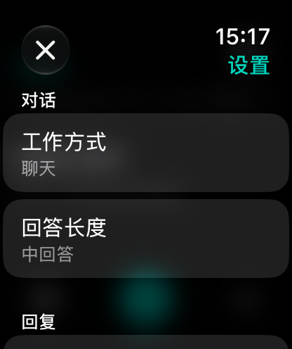

# 腕聊 · WristChat

运行在 Apple Watch 上的 AI 对话与写作应用。支持小米 MiMo、DeepSeek，以及多个 OpenAI 兼容接口，使用 SwiftUI、App Intents 与 WidgetKit 构建。

由 **canonliuliang** 制作，采用 **GPL-3.0-or-later** 开源。

## 功能

- 多轮对话、流式回答、停止与重试；按对话保存草稿和历史。
- 提供商、密钥、模型选择分别保存；发送前选择模型，旧版模型集中查看。
- 短、中、长回答使用 watchOS 原生选择器；可设置上下文、语言、字号、触感、个人偏好、蜂窝连接与语速。
- 静音隐藏朗读按钮并停止播放；非静音时可手动朗读、暂停和继续。
- MiMo 联网搜索；DeepSeek 联网先由 MiMo 检索，再交给 DeepSeek 回答，来源集中查看。
- Markdown 表格与代码块；表格可横向滑动。
- 作文工作台：真实素材、目标字数、实际正文计数、长文阅读与位置恢复。支持换开头、调整结尾、换立意、增减字数和润色，并保留旧稿。
- 作文指导面向长沙初三考场作文：切题、具体内容、真实情感、文学性，默认约800字。写作规则可以在设置中启用或关闭。
- Siri 提问、追问与写作文在后台完成，直接在 Siri 中回答。Siri 历史独立保存，不替换 App 当前对话和草稿。
- 表盘复杂功能与智能叠放快捷入口；关于页可查看制作署名、GPL 全文及实际签名期限。
- 历史后台串行原子保存，合并待写快照；相同成功快照不重复编码或写磁盘，未变化的回复不重复发布，作文解析使用有界缓存。

这是独立手表应用，不需要手机配套 App。关闭“联网搜索”仍需网络连接 AI 服务；不包含离线模型、持续语音通话或照片/文件上传。

## 编译与安装

工程当前面向 **watchOS 27+ / Xcode 27**，使用 Swift 6。个人版本已在 Apple Watch Series 11 46mm、watchOS27.2 上运行；其他设备需自行验证。核心 Swift Package 测试可在 macOS15+ 运行。

1. 克隆仓库并创建空白本地配置：

   ```sh
   git clone https://github.com/canonliuliang/WristChat.git
   cd WristChat
   python3 Scripts/generate_project.py
   ```

2. 用 Xcode 打开 `WristChat.xcodeproj`，选择 `WristChat` scheme。
3. 在 **Signing & Capabilities** 中选择自己的 Apple 开发团队，开启自动签名。也可重新生成工程并指定自己的团队：

   ```sh
   python3 Scripts/generate_project.py --team YOURTEAMID
   ```

   团队配置仅写入被忽略的 `.private/Signing.xcconfig`，不会写进公开工程。若 Xcode 提示应用标识已被使用，请将主 App、Widget 扩展和容器的 Bundle Identifier 改为自己的唯一标识，扩展标识以主 App 标识为前缀。`YOURTEAMID` 请替换成实际10位团队ID。

4. 在 Xcode 的 Device Hub 配对手表，按系统提示完成信任与开发者模式。选择真实手表后运行。`WristChatContainer` 只是 watch-only 工程的 iOS 包装目标。
5. App 主页左下角进入设置，在“提供商”选择服务，再进入“网络与密钥”填写自己的 API 密钥。密钥保存在手表系统钥匙串。
6. 点底部中间按钮输入问题，发送前可选择模型；右下加号新建对话，右上时钟查看历史。

首次打开 Xcode 前请先运行生成脚本：它会创建必需但不随仓库分发的空白本地文件，不会覆盖已有密钥。

## AI 服务配置

- **MiMo**：使用自己的 MiMo API 密钥。联网搜索还需在 MiMo 控制台开通对应服务，按提供商计费。
- **DeepSeek**：使用自己的 DeepSeek API 密钥。开启联网搜索时，也需要在 MiMo 提供商下配置可用的搜索密钥；DeepSeek API 请求本身不冒充内置网页搜索。
- **自定义提供商**：填写 HTTPS 的 OpenAI 兼容接口地址与自己的密钥，可获取服务端模型列表或手动填写模型ID。搜索与思考能力取决于当前实现和提供商支持。

对话请求会携带当前问题、选定上下文及个人偏好。DeepSeek 联网时，问题先发给 MiMo，检索资料再提供给 DeepSeek。无自建中转服务或分析 SDK。

仓库不包含可用 API 密钥、聊天记录、签名证书或个人安装包。生成脚本默认创建 **空白** `.private/BootstrapCredentials.plist`。如选择本地嵌入密钥，该密钥会进入自己的构建文件；不要把这样的安装包或本地配置公开分发。

## 验证

```sh
swift test --scratch-path .build/CoreTests

xcodebuild -project WristChat.xcodeproj -scheme WristChat \
  -configuration Debug -destination 'generic/platform=watchOS Simulator' \
  -derivedDataPath .build/Simulator CODE_SIGNING_ALLOWED=NO build
```

核心测试覆盖流式完成/失败/取消、请求与凭据隔离、搜索来源、历史保存与重试、上下文、表格、写作规则和 Siri 回复。手表帧率与耗电未做量化测量。系统朗读需真机试听；部分 watchOS 模拟器版本的语音组件存在限制。

`Scripts/*Probe.swift` 为按需验收工具，部分会真实调用模型并产生提供商费用，不属于离线测试。`DebugAcceptance.swift` 仅在 Debug 编译中启用，Release 不包含开发验收入口。

## 项目结构

- `WatchChat/`：SwiftUI 界面、对话存储、钥匙串、朗读与 Siri。
- `WatchChat/Core/`：可测试的请求、流式解码、历史、来源与写作逻辑。
- `Widgets/`：表盘与智能叠放入口。
- `Tests/`：离线核心测试。
- `Scripts/generate_project.py`：可复现的 Xcode 工程生成器。
- `Documentation/Design.md`：交互和实现说明。



## 许可证

Copyright © 2026 **canonliuliang**。仓库原创代码、测试、脚本、说明文字和应用图稿按 **GNU GPL 第3版或更新版本**提供。完整文本见 [LICENSE](LICENSE)，项目许可声明见 [NOTICE](NOTICE)。使用、修改和分发请遵守该许可证；软件不提供任何担保。

Apple、Apple Watch、Siri、MiMo、DeepSeek 及其他第三方商标、服务、模型和生成内容的权利遵循各自适用条款，不因本项目的 GPL 许可发生转移。
